# fly-brain-resuscitation

**In-silico anoxia, "brain death" and resuscitation on whole *Drosophila* connectomes.**
A leaky-integrate-and-fire (LIF) whole-brain model of FlyWire FAFB v783 (139,255 neurons, 3,732,460 connections), extended with a phenomenological metabolic and ionic layer. Damage-percolation analyses cover FAFB, BANC, MANC and MCNS.

> **Scope.** Every result in this repository is a **prediction of a computational model** with phenomenological constants that were not fitted to fly tissue. Nothing here shows that a real brain-dead animal can be revived, that resuscitation preserves the original neural pathways, or that the results transfer to other species. No biological brain has ever been resuscitated from brain death, and this work does not claim otherwise.


## What is in here

| path | content |
|---|---|
| `src/` | simulator engines `flysim.py` → `flysim_dyn.py` → `flysim_mech.py` (each adds options whose defaults leave numerics unchanged), `flysim_cns.py` (MCNS/BANC loaders), `perclib.py` (percolation/reachability engine), `light.py`, `toynet.py` (300-neuron synthetic connectome), `fbr_paths.py` (all paths), `build/` (cache builders) |
| `experiments/` | one folder per track (`sim`, `structure`, `dynamics`, `mechanism`, `replication`, `index`, `smoke`): sweep drivers, analysis scripts, `configs/` with the exact condition grids |
| `modal/` | container entry scripts used for the cloud sweeps, a bundle builder and a Modal app template |
| `results/` | summary tables (CSV/JSON, about 8 MB), one folder per track |
| `docs/` | [METHODS](docs/METHODS.md) · [REPRODUCE](docs/REPRODUCE.md) · [HYPOTHESES](docs/HYPOTHESES.md) (preregistration and verdicts) · [LIMITATIONS](docs/LIMITATIONS.md) · [RESULTS_SUMMARY](docs/RESULTS_SUMMARY.md) · [SYNTHESIS](docs/SYNTHESIS.md) · [VALIDATION_PROTOCOL](docs/VALIDATION_PROTOCOL.md) · paper PDFs and LaTeX in [paper/](paper/) · full track reports in [docs/reports/](docs/reports/) · bibliography and parameter table in [docs/lit/](docs/lit/) |
| `tests/` | pytest suite on the toy connectome: LIF stationarity, metabolic test (a), anoxia, FII metric, engine identity |
| `data/` | download instructions only; no FlyWire data is committed |

## Key findings (model predictions; numbers from results/KEY_CLAIMS.json)

1. **Headline: in a connectome-constrained LIF model with a phenomenological K+/ATP layer, abrupt reoxygenation can trap the model brain in a self-sustained K+-coupled high-activity state; a 10-20 s total activity block releases it. The trap is robust after long (180 s) anoxia and sign-sensitive after short (30 s) anoxia.** (180 s: runaway in 48/48 parameter sets (FAFB) and 5/5 MCNS runs; 30 s with antennal-lobe local neurons inhibitory: 0/3 FAFB runaway; confidence: high (180 s); moderate (30 s sign sensitivity)) [K01]
2. **Setting antennal-lobe local neurons inhibitory (147 sign changes in FAFB, 219 in MCNS) removed the high-rate runaway and the identity loss after 30 s anoxia. MCNS and FAFB-proxy kept a weak low-rate oscillation that the preregistered classifier still counts as runaway.** (FAFB variant A 0/3 runaway (late 0.035-0.17 Hz/neuron, raw FII 0.915-0.936); MCNS FII_norm 1.000 [0.996, 1.002] (3.0 Hz/neuron residual), delta +0.949 [+0.918, +0.977]; FAFB-proxy 0.859 (0.82 Hz/neuron); confidence: moderate (n = 3 FAFB, n = 5 MCNS/proxy; variants B, C not run)) [K03]
3. **After 180 s anoxia the runaway persisted with corrected antennal-lobe signs, and the 20-s total block still rescued identity.** (MCNS naive FII_norm -0.135 (FSA 0.897) vs block 0.989; FAFB-proxy naive -0.125 vs block 0.965; confidence: moderate-high) [K04]
4. **A 20-s total activity block at reperfusion restored the stimulus-response map; 2-5 s blocks failed; the block worked even when started 20 s late.** (FAFB FII_norm 1.001 / 0.953 at 30 / 180 s anoxia; rescue in 48/48 parameter sets at 30 s, 34/48 (0.71 [0.58, 0.83]) at 180 s; confidence: high) [K05]
5. **Releasing the block as soon as K+ and ATP had normalised was not enough: the network re-ignited.** (closed-loop criterion met after 11 s; MCNS runaway 5/5 (11.3 Hz/neuron), delta vs 20-s block -0.071 [-0.081, -0.058]; FAFB-proxy delta -0.674 [-0.742, -0.624]; confidence: moderate (MCNS + proxy only, 180 s, default signs)) [K06]
6. **The maintained runaway is ionic, not synaptic: it survives removal of all synapses and collapses when activity-dependent K+ accumulation is removed; quiet and active states coexist in the intact network.** (all synapses off: 109/134 Hz/neuron; K+ clamp 5 mM: 2.4/2.3 Hz/neuron; hysteresis >= 13 mV; confidence: high within model (default signs)) [K07]
7. **Simulated 'brain death' (silent and unresponsive) occurred only with near-total neuron death; the model never produced a silent but structurally intact brain.** (92 runs, all with >= 97.9% of neurons dead (of 1,209 FAFB runs); confidence: high (model property; FAFB only)) [K08]
8. **After the reset, remaining identity loss was due to neuron death; protecting the top 1% most-connected neurons was far more efficient per neuron than whole-brain protection, in two connectomes.** (FAFB ~30x (0.578 -> 0.703); MCNS 84x (+0.201 [+0.127, +0.278]); random sets no gain; confidence: high) [K09]
9. **Cooling before/during the insult widened the recoverable window, but the size of the effect is set by the model's injury rule; cooling only during reperfusion was harmful.** (D_max 359 / 271 / 149 / 124 model-s at 17 / 22 / 29 / 33 C; Q10_window 2.09 [1.99, 2.19]; confidence: high that it holds; magnitude is by construction, not a prediction) [K10]
10. **Graded (ramped or pulsed) reperfusion did not beat abrupt reperfusion plus a block (preregistered H3 falsified, direction reversed).** (360 s: ramp30 delta FII_norm -0.331 [-0.583, -0.130]; ramp60 +6.6 pp dead; confidence: high within model (no oxidative/inflammatory mechanisms modelled)) [K11]
11. **Structurally, random neuron loss degrades sensorimotor reachability gradually (no sharp threshold), whereas hub- or demand-targeted loss is far more destructive, in all four connectomes.** (FAFB random f_c 0.800 (width 0.671); area-weighted 0.277 (ratio 0.346); hub 0.033 (ratio 0.041); direction replicates 4/4; confidence: high (direction); magnitudes differ across datasets (f_c max/min up to 23.35)) [K12]
12. **Wiring statistics predict how much identity returns after the reset, but not whether the network gets trapped.** (post-reset FII: cross-validated R2 0.964 [0.940, 0.978] (excitatory core size); runaway among viable networks: AUC 0.53 (chance); confidence: moderate (FAFB only, 1,118 of 1,209 runs, default signs, no standalone report)) [K13]
13. **The small 'driver core' (0.5% of neurons) that rescued after 30 s anoxia under default signs is not established: it is centred on the antennal-lobe neurons whose sign correction removes the 30-s runaway.** (279 of 696 driver neurons in the antennal lobes; after 180 s, 20% of the brain had to be blocked; confidence: low (likely sign artefact) - do not message as a finding) [K14]
14. **Scope: all results are predictions of a simplified simulation (connectome-constrained LIF + phenomenological metabolism, constants not fitted to Drosophila). They are not evidence about living tissue, clinical brain death or human resuscitation; resuscitation of a brain-dead organism has not been demonstrated.** (3,487 analysed simulated condition-seed runs; dynamics in 2 connectomes (FAFB, MCNS); BANC dynamics not analysed; confidence: n/a (mandatory caveat for all messaging)) [K15]

Full verdicts: [docs/SYNTHESIS.md](docs/SYNTHESIS.md); summary table: [docs/RESULTS_SUMMARY.md](docs/RESULTS_SUMMARY.md); limitations: [docs/LIMITATIONS.md](docs/LIMITATIONS.md); proposed fly experiments: [docs/VALIDATION_PROTOCOL.md](docs/VALIDATION_PROTOCOL.md).

## Figure gallery

| 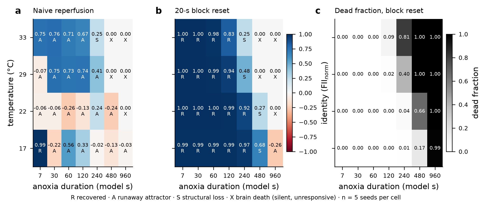 |
|:--|
| *Dynamics: brain-death map over insult type and duration* |

| 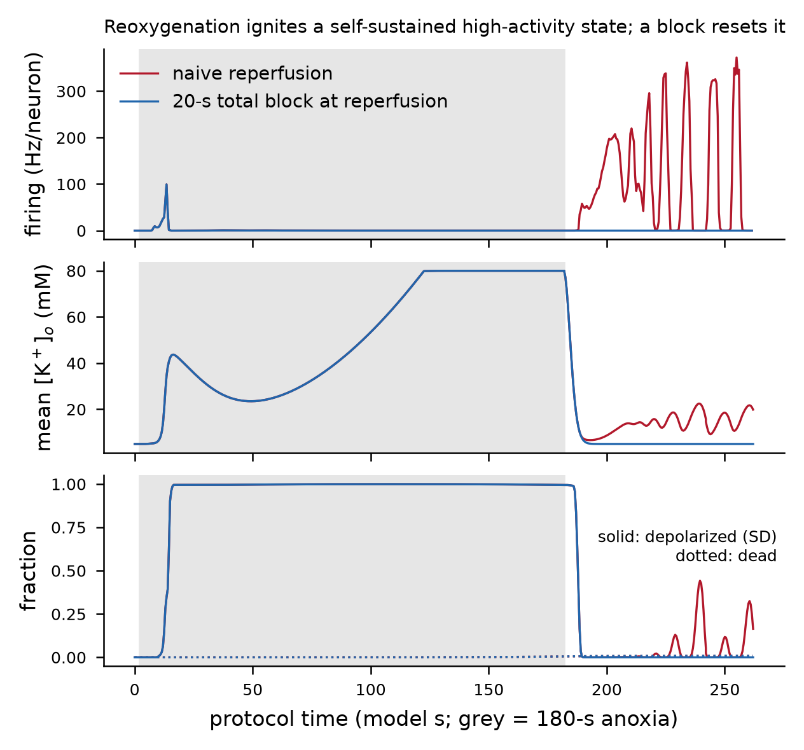 |
|:--|
| *Dynamics: activity, energy and K+ traces after 180 s anoxia (naive vs reset)* |

| 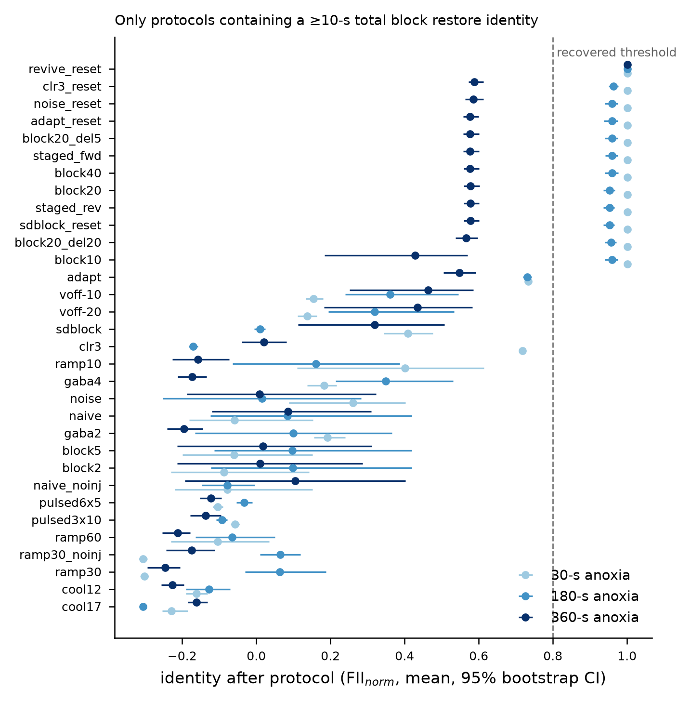 |
|:--|
| *Dynamics: resuscitation protocol ranking (FII_norm)* |

| 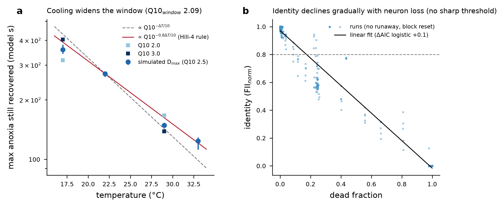 |
|:--|
| *Dynamics: (a) recovery window vs temperature (H4); (b) FII_norm vs dead fraction (H1)* |

| 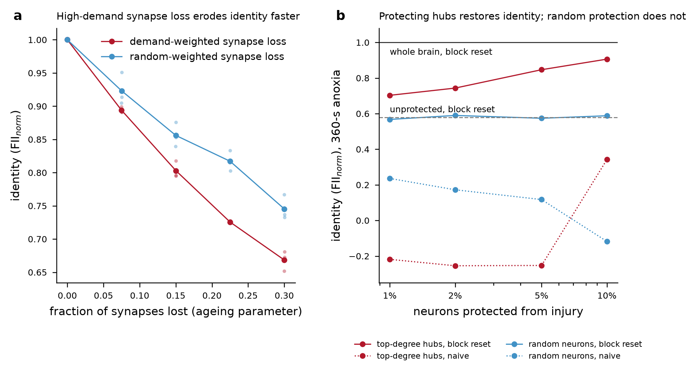 |
|:--|
| *Dynamics: ageing / reserve and targeted hub protection* |

| 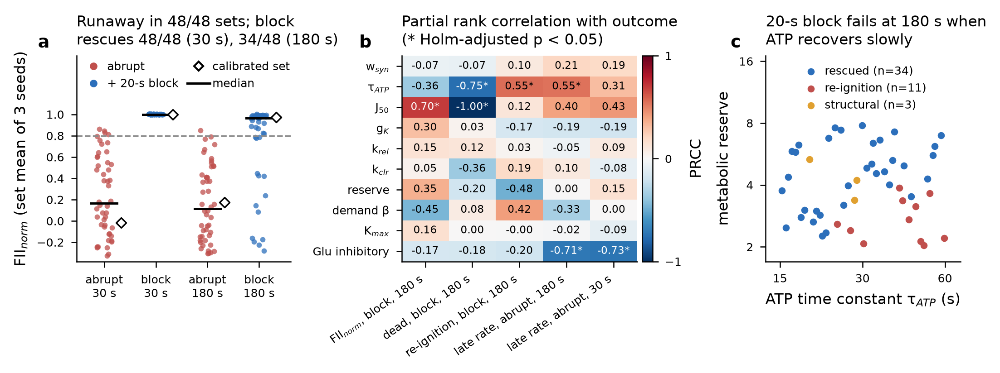 |
|:--|
| *Mechanism: runaway and reset robustness across 48 LHS parameter sets* |

| 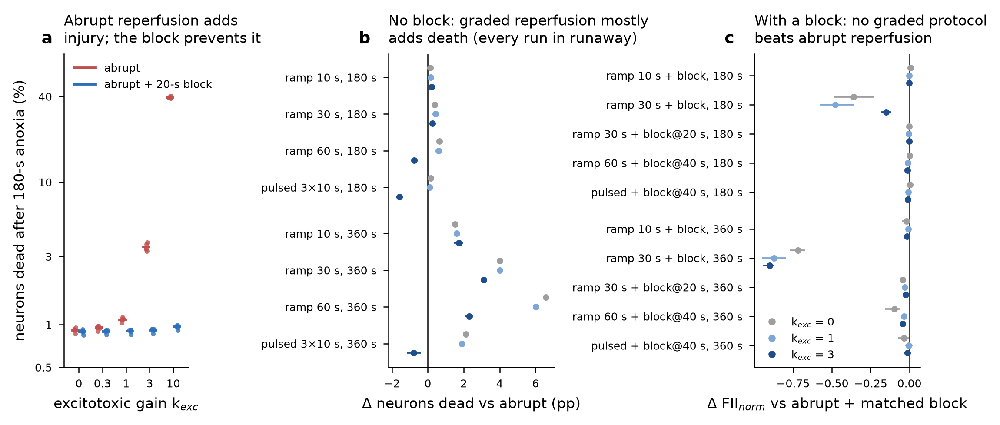 |
|:--|
| *Mechanism: excitotoxic reperfusion term and the H3 re-test* |

| 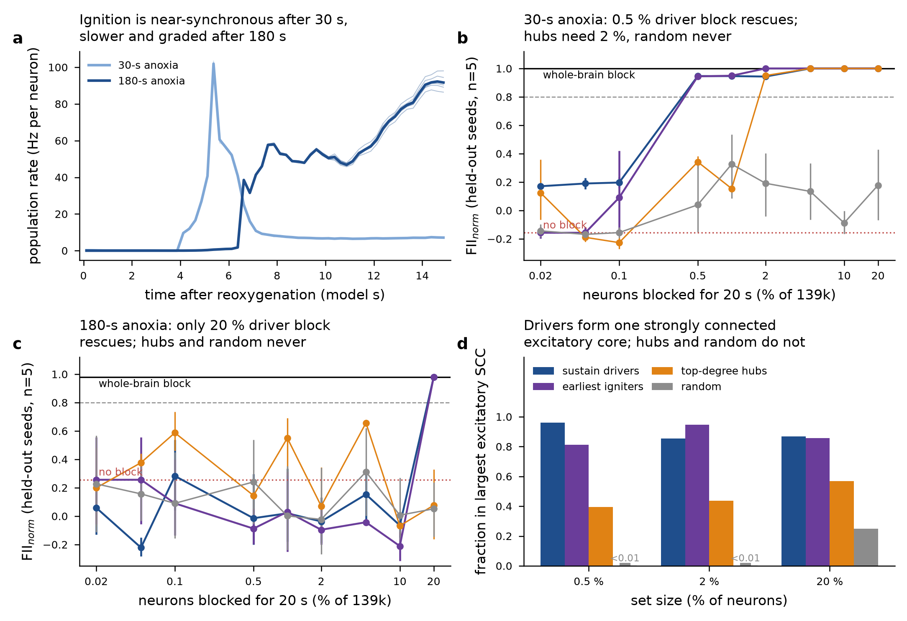 |
|:--|
| *Mechanism: attractor driver core and targeted reset* |

| 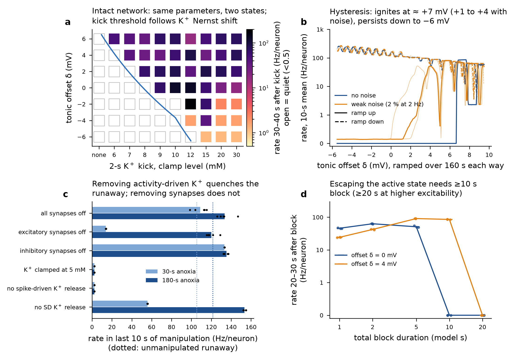 |
|:--|
| *Mechanism: bistability and hysteresis of the intact network* |

| 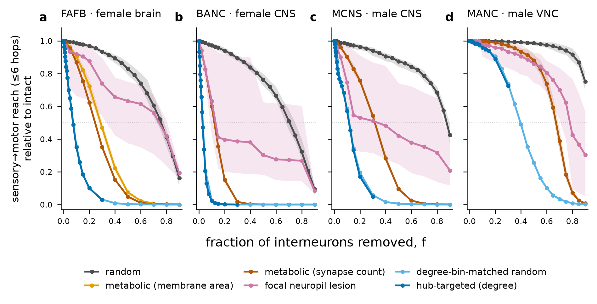 |
|:--|
| *Structure: sensorimotor reach vs damage fraction, four connectomes* |

| 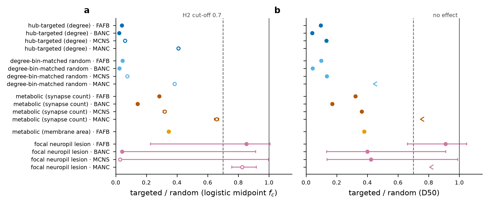 |
|:--|
| *Structure: targeted / random critical-fraction ratios* |

| 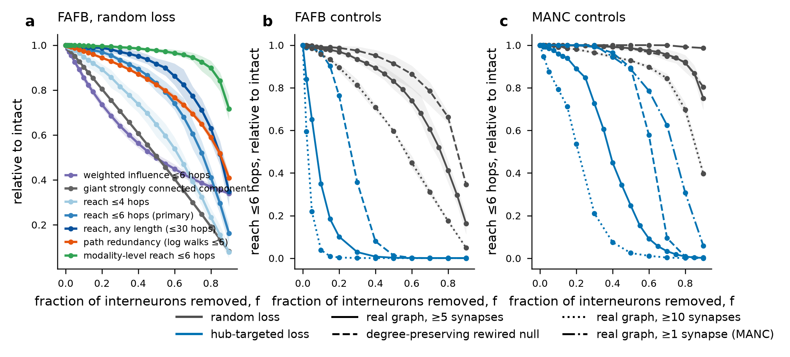 |
|:--|
| *Structure: metric failure order and controls* |

| 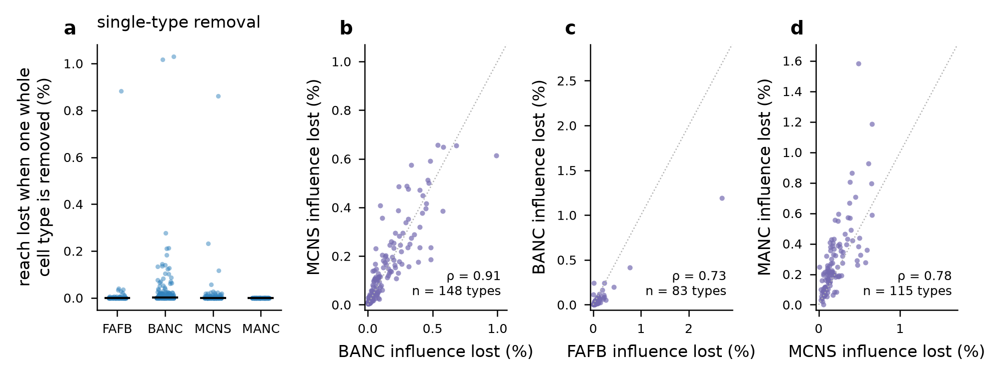 |
|:--|
| *Structure: keystone cell types* |

| 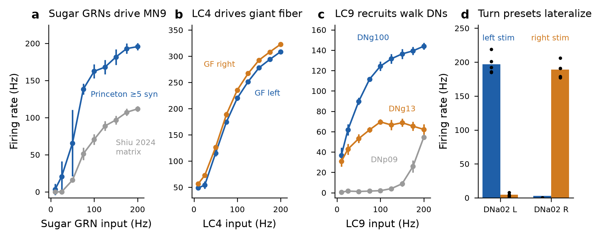 |
|:--|
| *Simulator: LIF validation against Shiu et al. 2024 readouts* |

| 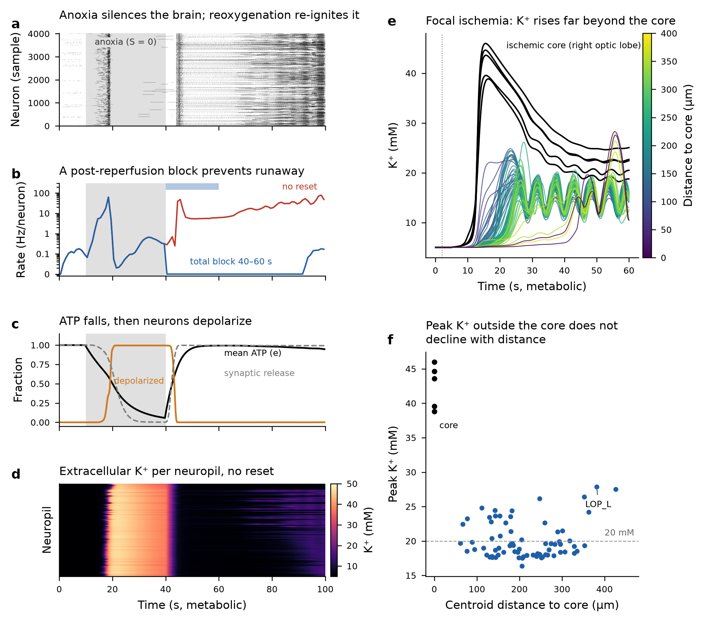 |
|:--|
| *Simulator: metabolic layer unit tests (anoxia, reoxygenation, reset)* |


## Quickstart

```bash
git clone https://github.com/KalarisLabs/fly-brain-resuscitation && cd fly-brain-resuscitation
conda env create -f environment.yml && conda activate flybrain     # or: pip install -r requirements.txt
pip install -e . && pytest -q                                       # toy-network tests, ~1 min, no data needed
python experiments/smoke/toy_protocol.py                            # insult -> reperfusion + block -> probe on the toy net
```

Full-connectome runs need the FlyWire downloads (several GB, not committed):

```bash
python scripts/fetch_data.py --check                    # lists required files, where they go and what is missing
python scripts/prepare_caches.py --fafb                 # builds the simulator caches (validated bit-exact)
python -c "import sys; sys.path.insert(0,'src'); import flysim_mech as fs; m=fs.load_model('princeton5'); \
r=fs.run(m,1000,stim=[dict(idx=m.idx(fs.SHIU_SUGAR_GRN),rate=150)]); print(fs.rates(r,m.idx([fs.SHIU_MN9])))"
```

[docs/REPRODUCE.md](docs/REPRODUCE.md) gives the exact command for every table and figure. One FAFB model uses about 0.5–1 GB of RAM per process.

## Data provenance and licence

The connectome data come from FlyWire and Codex ([codex.flywire.ai](https://codex.flywire.ai/)) and are distributed under CC-BY. The repository does not redistribute any of it. [data/README.md](data/README.md) lists the files and how to obtain them, and [DATA_LICENSE.md](DATA_LICENSE.md) lists the attribution and citations you must give when using them. The code is MIT-licensed ([LICENSE](LICENSE)).

## Credits

- **Author:** Srihari Muralikrishnan, Co-Founder & R&D Lead, Kalaris Labs ([ORCID 0009-0004-0220-0361](https://orcid.org/0009-0004-0220-0361), GitHub [@sriharideveloper](https://github.com/sriharideveloper)). Sole author; research direction and primary compute.
- **Secondary compute provider:** Sayan Chowdhury, Founder & CEO, Kalaris Labs.
- **Kalaris Labs** ([kalarislabs.com](http://kalarislabs.com/), [github.com/KalarisLabs](https://github.com/KalarisLabs/)): Myriad and Research Agent Skills.
- **AI:** Aryan Kumar Jha (Kalaris Labs). AI system: Claude (Anthropic). Claude is an AI tool, not an author.
- **Data:** FlyWire / Codex: FAFB v783, BANC, MANC and MCNS connectomes (CC-BY). Cite them as described in [DATA_LICENSE.md](DATA_LICENSE.md): [about Codex](https://codex.flywire.ai/about_codex), [FlyWire principles](https://flywire.ai/principles.html), [about FlyWire](https://codex.flywire.ai/about_flywire).
- **Contact:** hello@kalarislabs.com

See [ACKNOWLEDGMENTS.md](ACKNOWLEDGMENTS.md) and [CITATION.cff](CITATION.cff).
