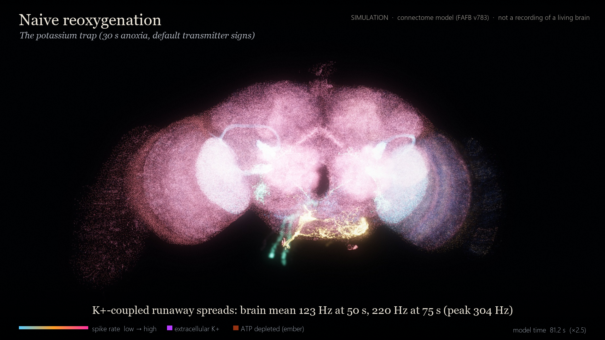
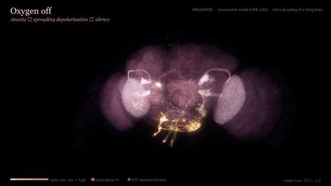
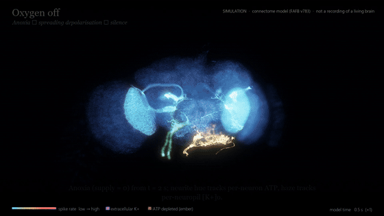
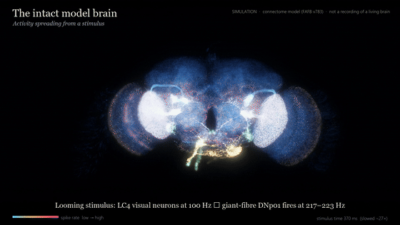
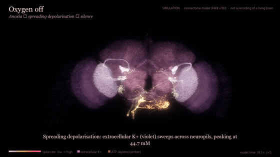
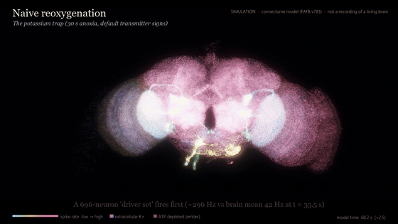
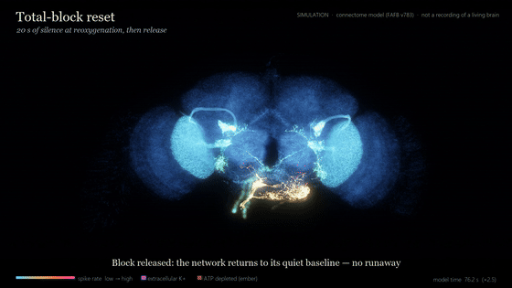
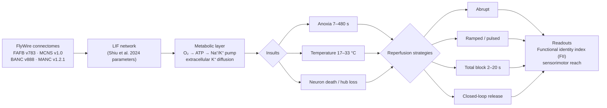

<div align="center">



# Reviving a model fly brain

### Anoxia, brain death and resuscitation in a connectome-constrained simulation of the adult *Drosophila* brain

[](paper/paper.pdf)
[](https://codex.flywire.ai/about_codex)
[](LICENSE)
[](environment.yml)
[](https://orcid.org/0009-0004-0220-0361)

**Srihari Muralikrishnan** · [Kalaris Labs](http://kalarislabs.com/)

</div>

---

> [!IMPORTANT]
> **What we found.** In a model of the whole adult fly brain (139,255 neurons, FlyWire FAFB v783), switching oxygen back on abruptly after a long outage (180 s) traps the network in a self-sustaining high-activity state, and its stimulus-response "identity" does not come back. A **20-second total activity block at reperfusion resets it**, and the identity returns. After a short outage (30 s), whether the trap appears depends on the transmitter sign assigned to antennal-lobe local neurons: making them inhibitory, as they are in real flies, removes the high-rate runaway.

> [!CAUTION]
> This is a simplified simulation: leaky integrate-and-fire neurons on a real wiring diagram, with a phenomenological K⁺/ATP layer whose constants were not fitted to *Drosophila*. It is a source of testable predictions, not evidence about living tissue. No real brain was revived.

## Watch

<table>
<tr>
<td width="50%" align="center">
<a href="media/explainer_public.mp4"></a><br/>
<b>Explainer: the story</b> · 3:18<br/><sub>Plain-language walkthrough, narrated</sub>
</td>
<td width="50%" align="center">
<a href="media/explainer_researcher.mp4"></a><br/>
<b>Explainer: methods and results</b> · 5:00<br/><sub>Model, experiments, numbers, limitations</sub>
</td>
</tr>
<tr>
<td align="center">
<a href="media/C1_intact.mp4"></a><br/>
<b>1 · Intact</b> · 29 s<br/><sub>Looming and taste stimuli propagate to descending and motor neurons</sub>
</td>
<td align="center">
<a href="media/C2_anoxia.mp4"></a><br/>
<b>2 · Oxygen off</b> · 32 s<br/><sub>ATP falls, a K⁺ front spreads, the brain goes silent</sub>
</td>
</tr>
<tr>
<td align="center">
<a href="media/C3_runaway.mp4"></a><br/>
<b>3 · Naive reperfusion</b> · 33 s<br/><sub>Oxygen back on: a K⁺-coupled runaway takes over</sub>
</td>
<td align="center">
<a href="media/C4_reset.mp4"></a><br/>
<b>4 · Block and reset</b> · 40 s<br/><sub>A 20-s total block, then the original responses return</sub>
</td>
</tr>
</table>

<sub>Click a preview for the full 1080p narrated video (release assets). Colours are driven by simulated spike rates and extracellular K⁺; geometry is FAFB v783 skeletons, synapses and somata. Every frame is a simulation.</sub>

## How it works



## Key results

| # | Result | Evidence | Confidence |
|:-:|---|---|---|
| 1 | After 180 s anoxia, abrupt reperfusion traps the model in a self-sustained runaway | 48/48 FAFB parameter sets; 5/5 MCNS runs | high |
| 2 | After 30 s anoxia, the trap is sign-sensitive: making antennal-lobe local neurons inhibitory removes the high-rate runaway and the identity loss (a weak low-rate oscillation remains in MCNS) | FAFB 0/3 runaway; MCNS FII<sub>norm</sub> 1.000 (3.0 Hz/neuron residual) | moderate |
| 3 | A 20-s total block at reperfusion restores the stimulus-response map; 2–5 s blocks fail; it still works when started 20 s late | FAFB FII<sub>norm</sub> 1.001 / 0.953 at 30 / 180 s | high |
| 4 | Releasing the block as soon as K⁺ and ATP normalise (11 s) is not enough: the network re-ignites | MCNS 5/5 runaway | moderate |
| 5 | The trapped state is ionic, not synaptic: it survives removing all synapses and collapses when K⁺ accumulation is clamped | 109/134 Hz with synapses off; 2.4/2.3 Hz with K⁺ clamp | high (model) |
| 6 | Model "brain death" (silent and unresponsive) needed near-total neuron death | all 92 such runs had ≥97.9 % dead | high (model) |
| 7 | Protecting the top 1 % most-connected neurons is far more efficient per neuron than whole-brain protection | ~30× FAFB; 84× MCNS | high |
| 8 | Graded (ramped or pulsed) reperfusion did not beat abrupt reperfusion plus a block | preregistered H3 falsified | high (model) |
| 9 | Random neuron loss degrades reachability gradually; hub-targeted loss is far more destructive | FAFB f<sub>c</sub> 0.800 random vs 0.033 hub-targeted | high (direction) |

Full numbers, intervals and caveats: [paper](paper/paper.pdf) · [supplement](paper/SUPPLEMENT.pdf) · [`docs/`](docs/).

<details>
<summary><b>What this model can and cannot say about brain death and resuscitation</b></summary>

- **Can:** show which wiring and ionic conditions let a whole-brain network return to its pre-insult input-output map, and which interventions (a total block at reperfusion, hub protection, cooling before the insult) widen that window *in the model*.
- **Cannot:** model oxidative stress, inflammation, glia, the blood-brain barrier, synaptic plasticity or memory storage. "Identity" here means the stimulus-response map of a fixed wiring diagram, not memories or experience.
- **Next step:** a real-fly validation protocol (optogenetic silencing at reoxygenation with GtACR or shibire<sup>ts</sup>, proboscis-extension and escape readouts) is in [`docs/`](docs/).

</details>

## Quickstart

```bash
git clone https://github.com/KalarisLabs/fly-brain-resuscitation.git
cd fly-brain-resuscitation
conda env create -f environment.yml && conda activate flybrain
pytest -q                       # unit tests on a tiny synthetic network
```

Connectome tables are not redistributed. Download them from [FlyWire Codex](https://codex.flywire.ai/) (FAFB v783 neurons and Princeton synapse table) and see [`data/`](data/) for the expected file names. The scripts in [`scripts/`](scripts/) regenerate each figure; [`experiments/`](experiments/) holds the sweep definitions.

<details>
<summary><b>Repository layout</b></summary>

| Path | Contents |
|---|---|
| `src/` | simulator (LIF + metabolic layer), structure and dynamics analysis |
| `experiments/` | sweep and follow-up experiment definitions |
| `scripts/` | figure and table reproduction |
| `results/` | summary tables (CSV/MD) |
| `paper/` | paper, review copy, supplement |
| `docs/` | methods, results summary, limitations, validation protocol |
| `tests/` | pytest unit tests |
| `modal/` | cloud sweep launchers |

</details>

## Cite

```bibtex
@misc{muralikrishnan2026flybrain,
  title  = {Anoxia, brain death and resuscitation in a connectome-constrained simulation of the adult Drosophila brain},
  author = {Muralikrishnan, Srihari},
  year   = {2026},
  note   = {Preprint, Kalaris Labs},
  url    = {https://github.com/KalarisLabs/fly-brain-resuscitation}
}
```

See also [`CITATION.cff`](CITATION.cff).

## Credits

| | |
|---|---|
| **Research, direction and primary compute** | Srihari Muralikrishnan, [Kalaris Labs](http://kalarislabs.com/) ([ORCID](https://orcid.org/0009-0004-0220-0361), [@sriharideveloper](https://github.com/sriharideveloper)) |
| **Secondary compute provision and institutional support** | Sayan Chowdhury, Founder & CEO, Kalaris Labs |
| **AI work** | Aryan Kumar Jha, Kalaris Labs |
| **Agent tooling** | Kalaris Labs [Myriad](https://github.com/KalarisLabs/myriad) and [Research Agent Skills](https://github.com/KalarisLabs/research-agent-skills) |
| **AI system** | Claude (Anthropic), used for analysis, code and drafting under the author's direction; disclosed in the paper, not an author |
| **Connectome data** | [FlyWire Codex](https://codex.flywire.ai/about_codex) and the [FlyWire consortium](https://codex.flywire.ai/about_flywire): FAFB v783, BANC v888, MANC v1.2.1, MCNS v1.0, used under the [FlyWire principles](https://flywire.ai/principles.html) |

Contact: hello@kalarislabs.com · Code MIT ([LICENSE](LICENSE)) · Data terms: [DATA_LICENSE.md](DATA_LICENSE.md)
